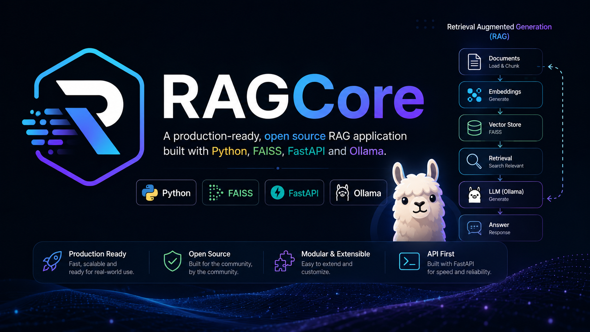
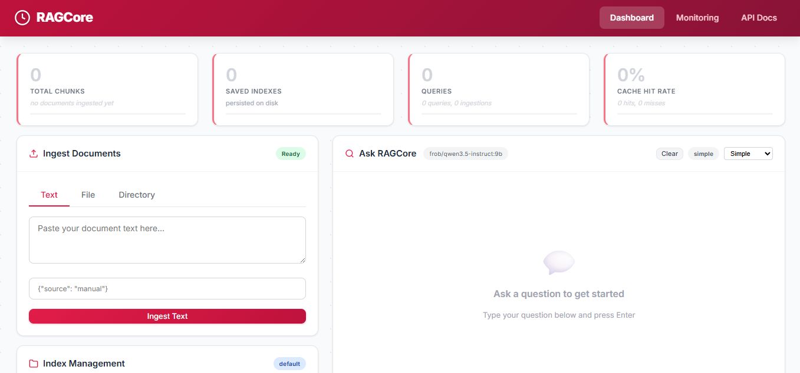
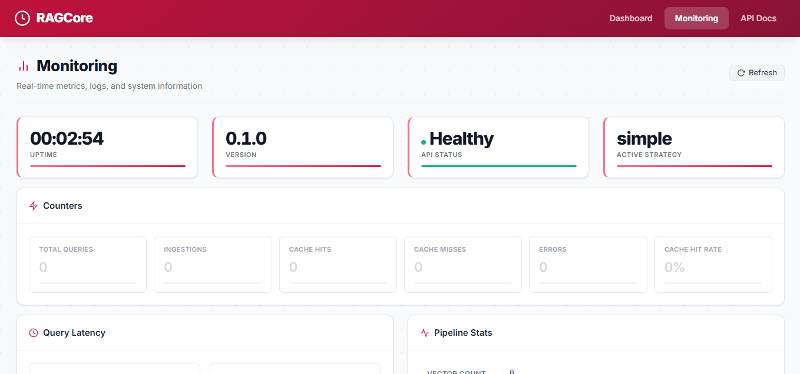

<div align="center">
  <h1>RAGCore</h1>
  <p><strong>Open source RAG framework powered by FAISS + Ollama + FastAPI</strong></p>

  <p>
    
    =3.11">
    
    
    
  </p>
  <p align="center">
    
  </p>
</div>

---

## Overview

RAGCore is an open source **Retrieval-Augmented Generation** framework that combines:
- **FAISS** — high-performance vector similarity search (cosine similarity via `IndexFlatIP`)
- **Ollama** — local LLM inference for embeddings and text generation
- **FastAPI** — async web server with OpenAPI docs, CORS, rate limiting, and monitoring

It provides a complete RAG pipeline: ingest documents → semantically chunk → embed → store in a vector index → retrieve relevant context → generate answers with an LLM.

### Use Cases

- Internal knowledge base Q&A
- Document chat over proprietary data
- Research assistance over large document collections
- Customer support augmentation
- Codebase documentation querying

## Features

- **Semantic Chunking** — embedding-aware boundary detection (not naive token splitting)
- **4 Retrieval Strategies** — Simple, MMR (diverse results), Hybrid (dense+sparse), Ensemble (weighted)
- **3-Tier Caching** — in-memory LRU + SQLite disk cache + semantic similarity response cache
- **Streaming Responses** — SSE-based token streaming for real-time UX
- **Web Dashboard** — built-in admin UI for queries, ingestion, and monitoring
- **REST API** — fully documented via Swagger UI at `/docs`
- **Monitoring** — live metrics (counters, timings, percentiles) + live log tailing
- **Multi-Format Ingestion** — TXT, PDF, DOCX, HTML, CSV, JSON, YAML, XML, Markdown
- **Multi-Index Management** — save, load, and switch between independent FAISS indexes
- **Rate Limiting** — configurable per-endpoint rate limits
- **Docker Support** — multi-stage build + docker-compose with Ollama
- **Chat Persistence** — conversation history saved in `localStorage`

## Screenshots

<div align="center">
  
  <p><em>Main dashboard — query, ingest, and manage your indexes</em></p>
</div>

<br>

<div align="center">
  
  <p><em>Monitoring dashboard — live metrics, log tailing, and pipeline stats</em></p>
</div>

## Quick Start

### Prerequisites

| Tool | Version |
|------|---------|
| Python | >= 3.11 |
| Ollama | >= 0.3.0 |
| pip | >= 24.0 |

### 1. Install Ollama

```bash
curl -fsSL https://ollama.com/install.sh | sh

# Pull required models
ollama pull nomic-embed-text:latest
ollama pull frob/qwen3.5-instruct:9b
```

### 2. Install RAGCore

```bash
git clone https://github.com/mohammednashaat/ragcore.git
cd ragcore

python3 -m venv .venv
source .venv/bin/activate

pip install -e .
cp .env.example .env
```

### 3. Start the Server

```bash
python -c "from ragcore import RAGApp; RAGApp().serve()"
```

Open [http://127.0.0.1:29000](http://127.0.0.1:29000) for the dashboard.

### 4. Ingest & Query

```bash
# Ingest text
curl -X POST http://127.0.0.1:29000/ingest/text \
  -H "Content-Type: application/json" \
  -d '{"text": "RAG stands for Retrieval-Augmented Generation..."}'

# Ask a question
curl -X POST http://127.0.0.1:29000/query \
  -H "Content-Type: application/json" \
  -d '{"question": "What does RAG stand for?"}'
```

## Python API

```python
from ragcore import RAGPipeline, RAGClient

# Full control
pipeline = RAGPipeline()
doc_ids = pipeline.ingest_text("Your content here")
result = pipeline.query("Your question?")
print(result["answer"])

# Lightweight client
rag = RAGClient()
result = rag.query_sync("What is RAG?")
print(result["answer"])

# Streaming
async for chunk in pipeline.query_stream("Tell me about RAG"):
    print(chunk, end="")
```

## Docker

```bash
docker compose up -d
# RAGCore runs on http://127.0.0.1:29000
# Ollama runs on http://127.0.0.1:11434
```

## Retrieval Strategies

| Strategy | Description | Best For |
|----------|-------------|----------|
| `simple` | Pure cosine similarity via FAISS | Fast, factual lookup |
| `mmr` | Maximal Marginal Relevance (diverse results) | Exploratory queries |
| `hybrid` | Dense (FAISS) + Sparse (BM25) with RRF fusion | Robust general-purpose |
| `ensemble` | Weighted combination of multiple retrievers | Production hedging |

```python
pipeline.set_retrieval_strategy("mmr")
```

## Architecture

```
┌─────────────┐   ┌────────────┐   ┌─────────────┐   ┌─────────────┐
│  Ingestion  │   │  Chunking  │   │  Embedding  │   │  Vector     │
│  (Loader)   │──▶│ (Semantic) │──▶│ (Provider)  │──▶│  Store      │
│  TXT/PDF/.. │   │            │   │  Ollama     │   │  (FAISS)    │
└─────────────┘   └────────────┘   └─────────────┘   └──────┬──────┘
                                                             │
┌─────────────┐   ┌────────────┐   ┌─────────────┐          │
│  Response   │◀──│   LLM     │◀──│  Retrieval  │◀─────────┘
│  (Chain)    │   │ (Provider) │   │  (Strategy) │
└─────────────┘   └────────────┘   └─────────────┘
       │
       ▼
┌──────────────────────────────────────────────────────────────┐
│  Caching Layer: LRU (Memory) → Disk (SQLite) → Semantic     │
│  Monitoring: Metrics, Tracing, Live Logs, Web Dashboard     │
│  API: FastAPI + Swagger + Rate Limiting + CORS              │
└──────────────────────────────────────────────────────────────┘
```

## Examples

Ready-to-run examples are in the [`examples/`](examples/) directory:

| File | Description |
|------|-------------|
| [`01_basic_import.py`](examples/01_basic_import.py) | Direct pipeline and client usage |
| [`02_custom_pipeline.py`](examples/02_custom_pipeline.py) | Custom chunking and retrieval |
| [`03_multi_index.py`](examples/03_multi_index.py) | Multiple index management |
| [`04_fastapi_embed.py`](examples/04_fastapi_embed.py) | Embed RAGClient in your FastAPI app |

## Configuration

| Category | Key Variables | Default |
|----------|--------------|---------|
| LLM | `RAGCORE_LLM_MODEL`, `RAGCORE_LLM_BASE_URL` | `frob/qwen3.5-instruct:9b`, `http://127.0.0.1:11434` |
| Embeddings | `RAGCORE_EMBEDDING_MODEL`, `RAGCORE_EMBEDDING_BASE_URL` | `nomic-embed-text:latest` |
| Chunking | `RAGCORE_CHUNK_MIN/MAX_TOKENS`, `RAGCORE_CHUNK_OVERLAP_TOKENS` | 200 / 1200 / 150 |
| Retrieval | `RAGCORE_RETRIEVAL_STRATEGY`, `RAGCORE_RETRIEVAL_TOP_K` | `simple` / 4 |
| Cache | `RAGCORE_CACHE_ENABLED`, `RAGCORE_CACHE_SEMANTIC_THRESHOLD` | `true` / 0.92 |
| Server | `RAGCORE_SERVER_HOST`, `RAGCORE_SERVER_PORT` | `127.0.0.1` / 29000 |

See [Configuration](docs/configuration.md) for the full reference.

## Documentation

| Resource | Description |
|----------|-------------|
| [Getting Started](docs/getting_started.md) | Installation, configuration, basic usage |
| [Configuration](docs/configuration.md) | Full environment variable reference |
| [Retrieval Strategies](docs/retrieval_strategies.md) | Strategy details and tuning |
| [Caching](docs/caching.md) | Cache architecture and configuration |
| [API Reference](docs/api_reference.md) | Python and REST API documentation |

## Project Structure

```
ragcore/
├── ragcore/             # Python package
│   ├── api/             # FastAPI server, routes, middleware, static UI
│   ├── cache/           # Semantic and TTL caching
│   ├── core/            # Config, exceptions, logging
│   ├── embeddings/      # Embedding provider + LRU/Disk cache
│   ├── ingestion/       # Document loaders, preprocessor, semantic chunker
│   ├── llm/             # LLM provider, chain, prompts
│   ├── monitoring/      # Metrics, tracing
│   ├── pipeline/        # RAG pipeline orchestrator + streaming
│   ├── retrieval/       # Base retriever + strategies
│   └── vectorstore/     # FAISS store + index manager
├── docs/                # Documentation
├── examples/            # Usage examples
├── tests/               # Test suite
├── Dockerfile           # Multi-stage Docker build
├── docker-compose.yml   # RAGCore + Ollama
└── pyproject.toml       # Package configuration
```

## Contributing

Contributions are welcome! Please follow these steps:

1. Fork the repository
2. Create a feature branch (`git checkout -b feature/amazing-feature`)
3. Commit your changes (`git commit -m 'Add amazing feature'`)
4. Push to the branch (`git push origin feature/amazing-feature`)
5. Open a Pull Request

### Development Setup

```bash
git clone https://github.com/mohammednashaat/ragcore.git
cd ragcore
python3 -m venv .venv
source .venv/bin/activate
pip install -e ".[dev]"
```

### Running Tests

```bash
pytest
```

### Code Quality

```bash
ruff check .
mypy ragcore
```

## License

Distributed under the MIT License. See `LICENSE` for more information.

## Author

**Mohammed Nashaat** — [mohammednashaat29@gmail.com](mailto:mohammednashaat29@gmail.com)
